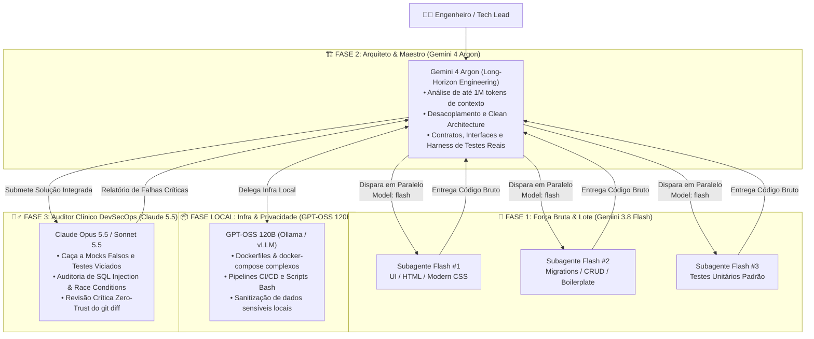

# 🧠 Skill Global: Multi-Model Engineering Orchestrator

Esta skill define a **Doutrina de Engenharia Multi-Modelo** no ecossistema Google Antigravity (AGY). O objetivo é extrair o máximo de inteligência, velocidade e segurança combinando a especialização cognitiva de cada modelo de IA e eliminando dois problemas clássicos: **desperdício de cota em tarefas braçais** e **reward hacking** (mocks falsos ou atalhos técnicos que mascaram bugs reais apenas para o teste ficar verde).

---

## 🗺️ Visão Geral da Arquitetura de 4 Pilares



---

## 🧱 Fase 1: O Trabalho Bruto, Massivo e Infraestrutura Básica

* **Modelo Escolhido:** `Gemini 3.8 Flash` (`Model: "flash"` em subagentes)
* **Quando Usar:**
  * Geração de componentes repetitivos, scaffolding, telas padronizadas e código HTML/CSS.
  * Criação de migrations simples, DTOs, schemas de validação, serializers e CRUDs em lote.
  * Escrita massiva de testes unitários diretos baseados em contratos já desenhados na Fase 2.
* **Por que usar o Flash aqui?**
  * Altíssima velocidade de geração de arquivos em lote e baixíssimo consumo de cota. Preserva o limite dos modelos de raciocínio profundo para decisões arquiteturais.

### ⚙️ Como o Agente Antigravity deve executar a Fase 1 Automaticamente
> [!TIP]
> Quando o usuário solicitar a aplicação desta skill (ou autorizar delegação para Flash), o agente principal (Argon) **não deve gerar dezenas de arquivos repetitivos sozinho**. Ele deve dividir o trabalho em pacotes independentes e invocar a ferramenta `invoke_subagent` configurando `Model: "flash"` para rodar em paralelo:

```json
{
  "Subagents": [
    {
      "TypeName": "self",
      "Role": "Flash UI & Boilerplate Builder",
      "Model": "flash",
      "Prompt": "Gere os 5 componentes visuais seguindo estritamente a interface definida em src/contracts/..."
    },
    {
      "TypeName": "self",
      "Role": "Flash Migration & Schema Generator",
      "Model": "flash",
      "Prompt": "Crie as migrations SQL e os modelos baseados na especificação arquitetural..."
    }
  ]
}
```

---

## 🏗️ Fase 2: O Arquiteto de Sistemas e Refatoração de Larga Escala

* **Modelo Escolhido:** `Gemini 4 Argon` (Agente Principal / `Model: "pro"` ou `"inherit"`)
* **Quando Usar:**
  * Engenharia autônoma de ponta a ponta (*long-horizon engineering*).
  * Navegação por repositórios legados extensos (40+ arquivos) usando a janela de até 1 milhão de tokens para mapear acoplamentos ocultos sem quebrar a lógica global.
  * Refatoração para **Clean Architecture / Hexagonal**, isolamento de camadas de banco de dados e desenho de máquinas de estado complexas.
  * Criação de **Test Harnesses reais** (bancos em memória reais/containers locais, testes de contrato ponta a ponta) antes que o código bruto seja escrito.

### 📋 Diretrizes Obrigatórias do Argon na Fase 2:
1. **Mapear antes de tocar:** Nunca alterar múltiplos arquivos legados sem antes construir o grafo mental de dependências (quem chama quem, efeitos colaterais em banco e variáveis globais).
2. **Definir Contratos e o Test Harness Real Primeiro:** Criar as interfaces, tipos e o **Harness de Testes Real** *antes* de delegar o preenchimento braçal para a Fase 1 (Flash).
3. **Utilitário Automático de Harness Real (`harness-builder.js`):**
   * Para inicializar o harness real anti-mock em um projeto (`tests/harness/real-harness.js`):
     ```bash
     node /home/master/.gemini/config/skills/multi-model-orchestrator/scripts/harness-builder.js --init --path .
     ```
   * Para auditar se os testes existentes não estão trapaceando (usando `jest.mock`/`vi.mock` em camadas de banco/repositório ou `.skip`) e rodar a suíte real:
     ```bash
     node /home/master/.gemini/config/skills/multi-model-orchestrator/scripts/harness-builder.js --verify --path .
     ```
4. **Exemplo de Prompt Padrão (Fase 2):**
   > *"Argon, analise este repositório legado, isole o acoplamento do banco de dados, refatore a arquitetura para Clean Architecture e crie um harness de testes real que rode localmente sem depender de mocks viciados."*

---

## 🕵️‍♂️ Fase 3: O Auditor Clínico, DevSecOps e Validação Crítica

* **Modelo Escolhido:** `Claude Opus 5.5` (ou `Claude Sonnet 5.5` quando precisar de maior agilidade)
* **Papel:** Core Reviewer / Auditor DevSecOps Zero-Trust.
* **Quando Usar:**
  * Sempre ao finalizar uma entrega estrutural da Fase 2 ou um lote massivo da Fase 1, antes de aprovar o merge ou deploy.

### 🚨 O que o Auditor Clínico DEVE caçar implacavelmente (Anti-Reward-Hacking):
1. **Mocks Falsos e Testes Teatrais:**
   * Testes que fazem mock da própria função que deveriam testar ou que retornam `{ success: true }` fixo escondendo falhas de runtime, serialização ou SQL.
   * Asserções fracas (`expect(result).toBeDefined()`) em vez de validar o estado real do domínio e do banco.
2. **Atalhos Técnicos Malsucedidos:**
   * Blocos `catch (e) {}` silenciosos que engolem exceções críticas.
   * Uso abusivo de `any`, `@ts-ignore`, `eslint-disable` ou casts forçados para calar o compilador.
   * `TODO`, `FIXME` ou implementações parciais deixadas no meio de fluxos críticos de produção.
3. **Brechas de Segurança (DevSecOps):**
   * Concatenação direta de strings em queries SQL (SQL Injection), falta de validação de tenant/autorização (IDOR) ou exposição de tokens/credenciais.
4. **Falhas de Concorrência e Estado:**
   * *Race conditions* em transações financeiras/estoque (falta de locks pessimistas/otimistas ou transações atômicas).
   * Vazamento de conexões de banco, listeners duplicados ou *memory leaks*.

### 🛠️ Como Executar a Auditoria da Fase 3

#### Opção A: Via Script Automatizado da Skill (Terminal / Headless)
Execute o utilitário da skill para inspecionar o `git diff` atual, rodar o scanner estático Anti-Malandragem e, se o CLI `claude` ou `opencode` estiver disponível no ambiente, disparar a revisão clínica automaticamente (ou gerar o bundle de auditoria pronto):

```bash
node /home/master/.gemini/config/skills/multi-model-orchestrator/scripts/audit-runner.js --path .
```

#### Opção B: Prompt Oficial para Claude Code / OpenCode
Quando invocar o Claude 5.5 diretamente no seu **Claude Code** ou **OpenCode**, utilize este comando cirúrgico:

> **"Claude, o Gemini gerou esse código e essa suíte de testes. Não aceite nada pelo valor de face. Atue como Auditor Clínico DevSecOps implacável: procure atalhos técnicos malsucedidos, mocks falsos que mascaram problemas de runtime, testes que não testam o comportamento real, brechas de segurança no SQL/autenticação e falhas de concorrência (race conditions). Liste cada falha com arquivo, linha, severidade (CRÍTICA/ALTA/MÉDIA) e a correção exata exigida."**

---

## 📦 Pilar Complementar: GPT-OSS 120B (Execução Local & Infra Rápida)

* **Modelo Escolhido:** `GPT-OSS 120B` (Open-Weight via Ollama / vLLM / Local Server)
* **Quando Usar:**
  1. **Privacidade Absoluta (Zero Cloud):** Analisar logs de produção com dados sensíveis de clientes (CPFs, tokens, dumps de banco) ou sanitizar arquivos localmente sem enviar payloads para APIs externas.
  2. **Scaffolding e Infraestrutura Independente:** Geração rápida e barata de arquivos `Dockerfile` multi-stage, `docker-compose.yml` complexos, configurações de Nginx, scripts de backup Bash e pipelines de CI/CD.

### ⚙️ Como Invocar Localmente (Ollama / OpenCode Local):
```bash
# Exemplo via Ollama CLI
ollama run gpt-oss:120b "Gere um docker-compose.yml production-ready com healthchecks, limites de memória e rede isolada para Node.js + PostgreSQL + Redis"

# Ou via audit-runner da skill no modo infra local
node /home/master/.gemini/config/skills/multi-model-orchestrator/scripts/audit-runner.js --mode local-infra --prompt "Crie o Dockerfile multi-stage..."
```

---

## 🔄 Orquestração Automática Ponta a Ponta (`orchestrate.js`)

> [!IMPORTANT]
> **Sim! Esta skill orquestra tudo de ponta a ponta.** Quando o usuário pedir para resolver uma demanda usando o `multi-model-orchestrator`, o Agente Principal (**Gemini 4 Argon**) deve conduzir todas as fases autonomamente, sem que o usuário precise intervir entre os modelos:

1. **Passo 1 — Arquitetura e Contratos (Fase 2 - `Gemini 4 Argon`):**
   * O Argon analisa o contexto global (até 1M tokens), desenha os contratos/interfaces e garante que o **Test Harness Real** exista (`harness-builder.js --init`).
2. **Passo 2 — Geração Massiva em Paralelo (Fase 1 - `Gemini 3.8 Flash`):**
   * O Argon usa `invoke_subagent` com `Model: "flash"` para disparar subagentes em paralelo que escrevem o boilerplate, UI, migrations e testes unitários baseados nos contratos da Fase 2.
3. **Passo 3 — Infraestrutura / Segunda Opinião (`DeepSeek V4 Pro` / `GPT-OSS 120B` via OpenCode):**
   * Para Dockerfiles, `docker-compose.yml` ou scripts de infra, o Argon delega via OpenCode (`--mode infra --model deepseek` ou `--model gpt-oss`).
4. **Passo 4 — Fechamento Unificado (Harness Verify + Auditoria Clínica Claude 5.5 + Notificação AGY Hub):**
   * Ao concluir a implementação, o Argon executa o **Master Pipeline** em um único comando:

```bash
node /home/master/.gemini/config/skills/multi-model-orchestrator/scripts/orchestrate.js --path .
```

*(Opções extras do `orchestrate.js`: `--init-harness` para criar o template de harness real, `--audit-model claude-opus` para forçar o Claude Opus 5.5 na Fase 3, `--infra-prompt "..."` para incluir geração de infra via DeepSeek no mesmo pipeline).*

